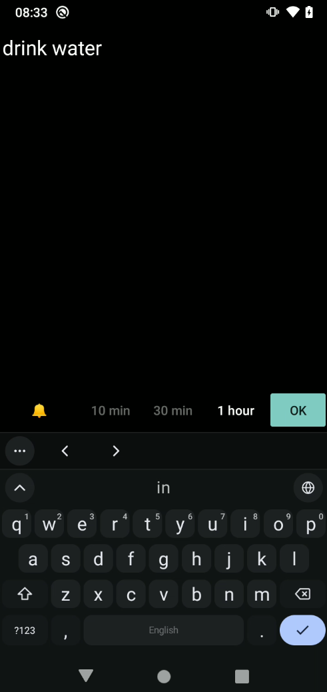

# Simplest Reminder

A single text box. Type a reminder, pick 10 min / 30 min / 1 hour, press OK.

Blazingly fast.

## Install

Download the APK from the [releases page](https://github.com/andunieee/simplest-reminder/releases/latest) and install it on your phone.

## Extra features

Touch and hold a preset (10 min / 30 min / 1 hour) to change its default time, and tap 🔔 to choose silent or loud notifications. Touch and hold OK to give one reminder a custom time, either relative (`45m`, `1h30`, `in 3 days`) or absolute (`14:30`, `9am`).
